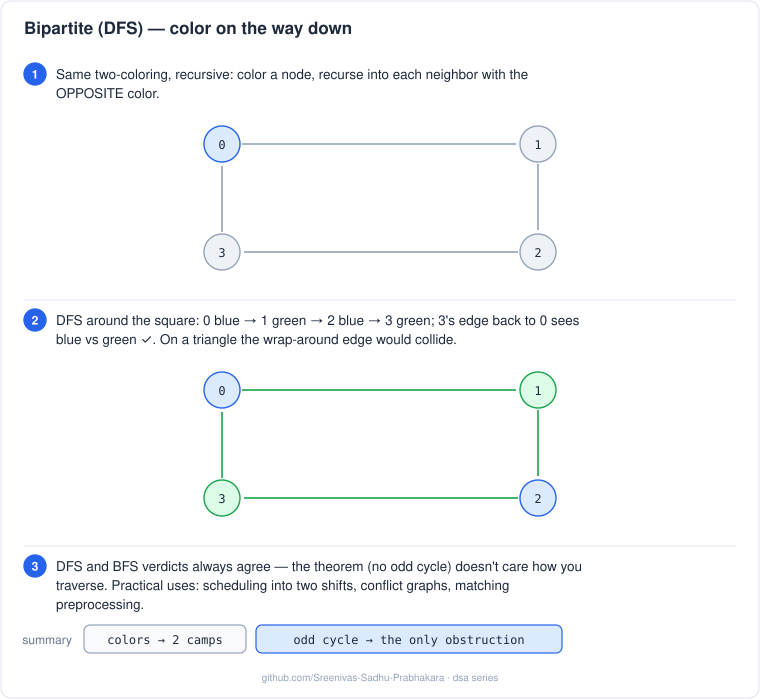

# Bipartite Check (DFS)

> Striver SDE Sheet 163 · Day 23 Graph — the 2-coloring argument carried by recursion: paint, flip for neighbors, fail on a same-color edge. Go, stdlib only, tested.

## Problem

Bipartiteness once more, DFS-flavored — the sheet's recurring pattern of solving one property with both traversals to show the property, not the traversal, is what matters.

## Approach

`paint(v, c)` colors v and recursively paints uncolored neighbors with the flipped color, propagating failure upward the moment any neighbor already wears v's own color. The parity view: DFS depth alternates colors along tree edges, so a same-color conflict is a back edge closing an odd cycle — identical mathematics to the BFS version (#162), different vehicle. Odd vs even cycles are pinned by 6-cycle/7-cycle tests. One practical note: the recursion depth tracks the longest path, so for adversarially long path graphs the BFS twin is the safer production choice.

**Complexity:** O(V+E) time, O(V) recursion.

## Visual walkthrough

Read the picture top to bottom — each numbered frame is one moment of the algorithm
running on this repo's test example.

## Run

    go test ./...   # verify
    go run .        # demo

---

One of 191 repos solving Striver's SDE Sheet in Go — stdlib only, one problem per repo, every solution tested. Browse the set: [`dsa-*` repos](https://github.com/Sreenivas-Sadhu-Prabhakara?tab=repositories&q=dsa-&type=source).
